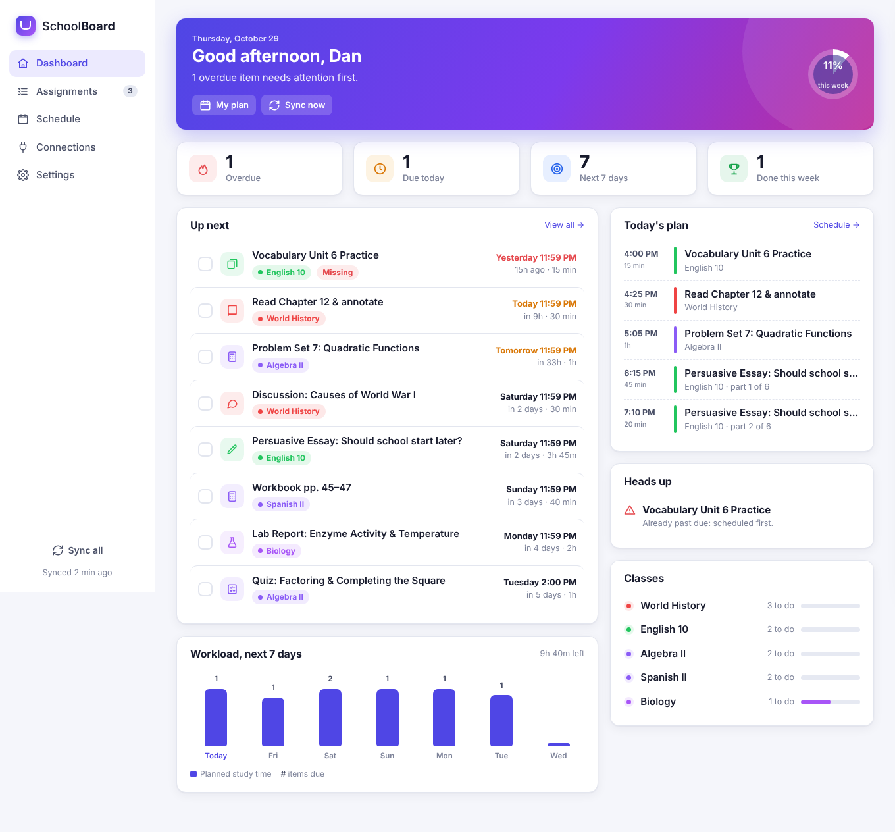
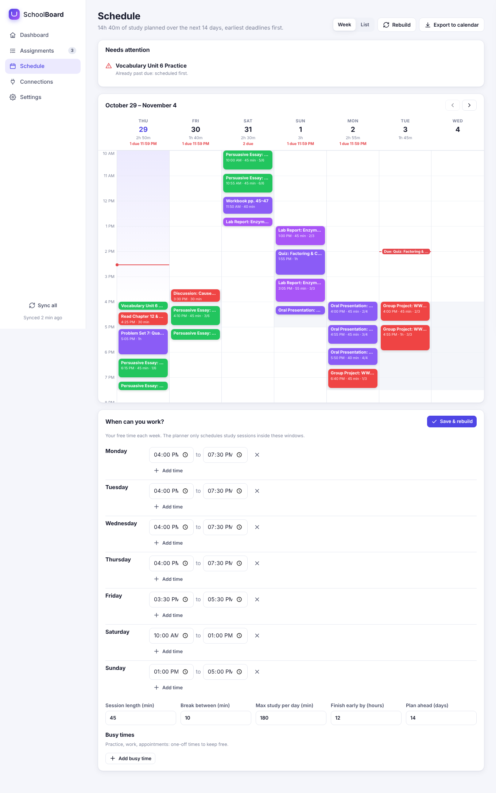
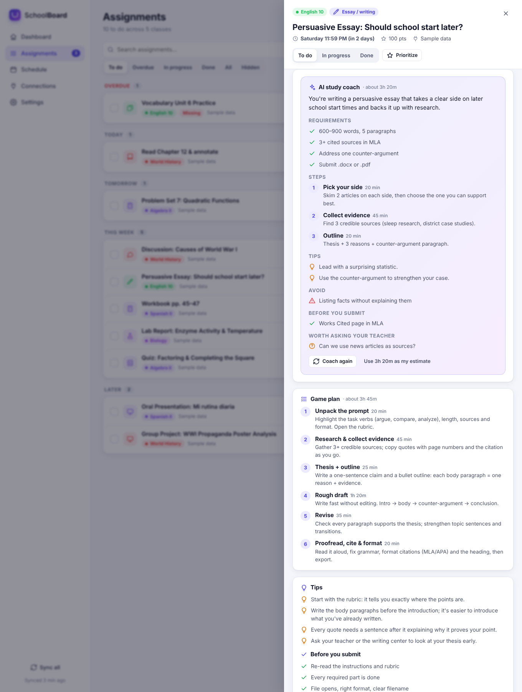

# School Dashboard

One dashboard for all your schoolwork. It connects to the platforms your classes use, shows what's due, explains how to do it and how to submit it, and builds a study schedule around your free time.



## What it does

- **Connects your platforms** and merges everything into one list. You can connect several at once.
  - **Canvas**: uses a personal access token. You get full detail: instructions, points, submission types, allowed file types, and whether you've already submitted.
  - **Schoology**: uses your own API key and secret.
  - **Moodle**: uses your mobile-app security key.
  - **Calendar feed (any platform)**: paste an iCal link from Google Classroom, Blackboard, Brightspace (D2L), Schoology, Canvas, Moodle, Teams/Outlook, PowerSchool or anywhere else. The connect form shows where to find the link on each platform.
  - **Add by hand**: for paper handouts or anything your teacher said in class.
  - **Sample data**: try everything before connecting a real account.
- **Dashboard**:
  - overdue, due-today and next-7-days counts;
  - an "Up next" list and today's study plan;
  - a 7-day workload chart, progress for each class, and warnings when something won't fit.
- **Every assignment** opens a detail panel with:
  - **What to do**: the teacher's instructions, cleaned up and safe to display.
  - **How to submit**: file upload, text entry, link, recording, on paper, quiz, discussion, outside tool, with practical advice for each and the allowed file types. There's also a button that goes straight to the submission page.
  - **Game plan and tips**: steps with time estimates and tips for the kind of work it is (essay, lab report, presentation, project, quiz prep, discussion post, reading, problem set, video, vocab practice), plus a checklist for before you submit. This part works with no AI.
  - **AI study coach** (optional, uses Claude). It gives:
    - a plain-English summary of what's being asked and the requirements it pulled out;
    - steps tailored to that assignment, with tips and pitfalls;
    - a checklist for before you submit, and questions worth asking your teacher.

    It coaches; it doesn't do the work for you.
  - Status (to do / in progress / done), priority, your time estimate, time logging, and notes.
- **Schedule builder**:
  - You set the times you're free each week and add one-off busy times (practice, work…).
  - You choose session length, break length, a daily maximum, and how many hours before the deadline you want to be finished.
  - The planner fits your remaining work into those times, earliest deadline first. Large tasks are split across days, and anything that can't make its deadline is flagged.
  - You can view the plan as a week calendar or a list, tick off sessions ("Did it"), or **export it to your calendar** (.ics).
- **Stays in sync**:
  - When you open the dashboard, it re-syncs if the last sync is over 30 minutes old.
  - Your own notes, estimates and statuses are kept across syncs.
  - Anything you submit on Canvas is marked done automatically.
- Light/dark mode, and works on a phone or iPad (bottom tab bar, list-style schedule).

| Schedule | Assignment detail |
|---|---|
|  |  |

## Run it

Requires Python 3.10+.

```bash
python -m venv .venv
source .venv/bin/activate          # Windows: .venv\Scripts\activate
pip install -r requirements.txt

python run.py                      # opens http://127.0.0.1:8010
```

Then go to **Connections** and connect your platform, or press **Load sample data** to look around first.

### Optional: AI study coach

Get an API key from [platform.claude.com](https://platform.claude.com), then set it before starting:

```bash
export ANTHROPIC_API_KEY=sk-ant-...  # Windows (PowerShell): $env:ANTHROPIC_API_KEY="sk-ant-..."
python run.py
```

Everything else works without a key.

### Settings (environment variables)

| Variable | Default | Purpose |
|---|---|---|
| `SCHOOLBOARD_DB` | `data/schoolboard.db` | Where your data is stored (SQLite) |
| `SCHOOLBOARD_MODEL` | `claude-opus-5-5` | Claude model for the coach |
| `SCHOOLBOARD_EFFORT` | `medium` | Coach effort (`low`…`max`) |
| `SCHOOLBOARD_FALLBACKS` | `1` | Server-side refusal fallback (`0` to turn off) |
| `PORT` / `HOST` | `8010` / `127.0.0.1` | Server address |

## Connecting each platform

| Platform | What you need | Where to find it |
|---|---|---|
| Canvas | School address + access token | Canvas → Account → Settings → Approved Integrations → **+ New Access Token** |
| Schoology | Consumer key + secret | `https://<your-school>.schoology.com/api` while signed in |
| Moodle | Site address + security key | Profile → Preferences → **Security keys** → *Moodle mobile web service* |
| Google Classroom | Calendar feed link | Google Calendar → Settings → the class calendar → Integrate calendar → **Secret address in iCal format** |
| Blackboard | Calendar feed link | Calendar → Settings → **Share Calendar** |
| Brightspace (D2L) | Calendar feed link | Calendar → **Subscribe** |
| Anything else | Calendar feed link | Look for "Export", "Subscribe", "iCal" or "Calendar feed" |

If a school has turned off tokens or API keys, use that platform's calendar feed instead.

Calendar feeds can include things that aren't assignments, such as class meetings. Open one and press **Hide from my list** to remove it.

## Privacy

Your assignments, notes and platform tokens are stored only in `data/schoolboard.db` on the computer running the app. The server listens on `127.0.0.1` by default, and tokens are never sent back to the browser. Each token is only sent to the platform it belongs to. The AI coach sends a single assignment's details to Claude, and only when you press **Coach me on this**.

## Project layout

```
run.py                  start the server
app/main.py             FastAPI routes
app/connectors/         canvas, schoology, moodle, ical (any platform), demo
app/tips.py             built-in categories, time estimates, steps, tips, submission guidance
app/ai.py               optional Claude study coach (structured output)
app/scheduler.py        study-plan builder + .ics export
app/htmlclean.py        sanitizes teacher-written HTML
app/db.py               SQLite storage
app/static/             front end (plain HTML/CSS/JS, no build step, works offline)
tests/                  pytest suite (platform APIs are mocked)
```

Run the tests with `pip install pytest httpx && pytest`.
